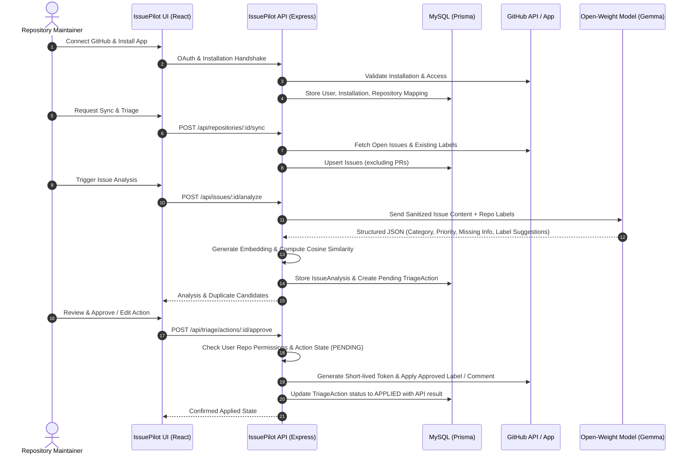

# IssuePilot — System Architecture

## 1. Overview
IssuePilot is a production-minded, human-in-the-loop GitHub issue management platform. It combines GitHub App integration, open-weight instruction models (such as Gemma), and semantic embeddings to assist open-source maintainers and developer teams in triaging issues efficiently without sacrificing oversight.

The system is architected around one core principle:
**AI proposes actions; authenticated humans review and approve them before any write operation is committed to GitHub.**

---

## 2. Monorepo Structure

```text
Issue-pilot/
├── client/                     # Vite + React 18 + Tailwind CSS frontend
│   ├── src/
│   │   ├── components/         # Reusable UI primitives and domain widgets
│   │   ├── layouts/            # Dashboard and App shell layouts
│   │   ├── pages/              # Landing, repos, issue explorer, detail, approvals, settings
│   │   ├── hooks/              # Auth, repo, issue, and query hooks
│   │   ├── services/           # Typed API client functions
│   │   └── utils/              # Formatters, badges, date helpers
│   ├── index.html
│   └── vite.config.js
├── server/                     # Node.js + Express (ESM) backend
│   ├── prisma/
│   │   └── schema.prisma       # Relational MySQL schema
│   ├── src/
│   │   ├── config/             # Environment, logger, constants
│   │   ├── middleware/         # Auth, repo authorization, rate-limiting, error handling
│   │   ├── controllers/        # Express route handlers
│   │   ├── routes/             # REST endpoints (auth, github, repos, issues, triage, webhooks)
│   │   ├── services/           # Core business logic:
│   │   │   ├── github-app.service.js       # App JWT, installation tokens, Octokit
│   │   │   ├── github-sync.service.js      # Repository & issue synchronization
│   │   │   ├── ai-provider.service.js      # Pluggable Gemma / OpenAI-compatible client
│   │   │   ├── ai-triage.service.js        # Strict Zod-validated issue analysis
│   │   │   ├── embedding.service.js        # Text embedding generation
│   │   │   ├── duplicate-detector.service.js# Cosine similarity matching
│   │   │   └── triage-action.service.js    # Idempotent write execution
│   │   ├── validators/         # Zod schemas for requests and AI responses
│   │   ├── utils/              # Cryptographic verification, structured logging
│   │   ├── app.js              # Express app setup
│   │   └── server.js           # HTTP server initialization
│   └── tests/                  # Vitest + Supertest integration test suite
├── docs/                       # Comprehensive documentation
├── .env.example                # Canonical environment template
├── README.md
└── package.json
```

---

## 3. High-Level Data Flow



---

## 4. Key Subsystems

### 4.1 Authentication & Authorization
- **Authentication**: GitHub OAuth 2.0 Web Application flow creates a secure session stored in a cookie.
- **GitHub App Installation**: A decoupled flow where maintainers grant IssuePilot access to specific repositories.
- **Authorization Enforcement**: Every protected route verifies that the authenticated user has explicit read/admin access to the targeted repository before any query or action is permitted.

### 4.2 Issue Synchronization
- Uses GitHub App installation access tokens (valid for 1 hour, auto-refreshed).
- Filters out pull requests (`issue.pull_request === undefined`).
- Stores GitHub metadata, labels, issue author, and body hash to detect updates.

### 4.3 AI Engine & Provider Abstraction
- Defined by a clean interface: `analyzeIssue(issue, context)`.
- Implemented with an adapter pattern supporting:
  - Hosted Open-Weight inference (e.g., Groq, OpenRouter, Together running Gemma 2 9B/27B).
  - Local inference (e.g., Ollama or vLLM).
- Strict output validation using **Zod**: guarantees category, priority, and suggestions adhere strictly to valid repository labels and domain enums.
- Prompt injection protection: issue text is treated as untrusted data wrapped in structured boundaries.

### 4.4 Semantic Duplicate Detection
- Issues are vectorized using an embedding model.
- Candidate comparison excludes the target issue itself and non-issues.
- Cosine similarity computes ranking scores. Candidates above a configurable threshold are surfaced with deep links and confidence metrics.

### 4.5 Approval & Write Workflow
- All label applications or comment drafts start in `PENDING` state.
- Write actions cannot be performed without authenticated user consent.
- Concurrency and double-application safeguards ensure idempotency.
